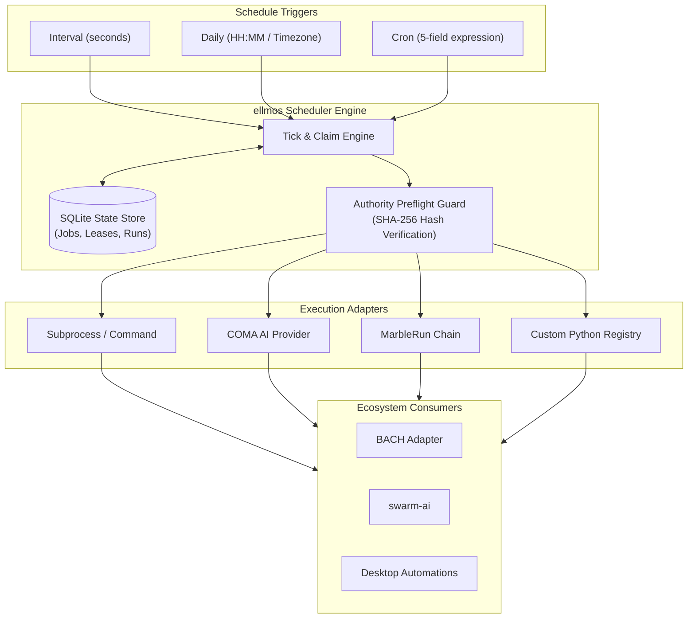
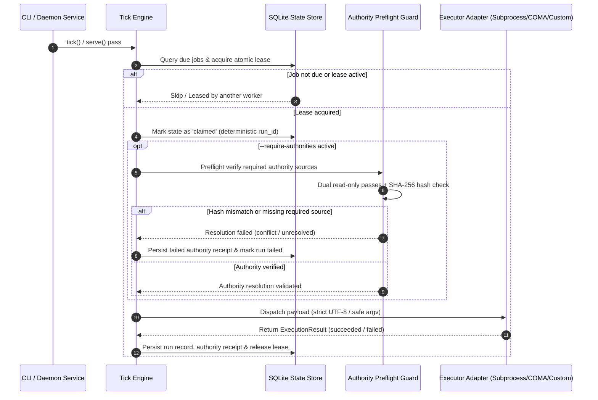

# ellmos Scheduler


[](https://github.com/ellmos-ai/ellmos-scheduler)
[](https://github.com/ellmos-ai/ellmos-scheduler/actions)
[](https://python.org)
[](https://github.com/ellmos-ai/ellmos-scheduler)
[](LICENSE)
[](NOTICE)
[](https://github.com/ellmos-ai/ellmos-scheduler/actions/workflows/test.yml)
[](https://github.com/astral-sh/ruff)
[](SECURITY.md)
[](SECURITY.md)
[](THIRD_PARTY_LICENSES.md)
[](MARKETING-LOG.txt)
[](https://github.com/ellmos-ai)
[](https://github.com/open-bricks)
[](llms.txt)
[](llms.txt)
[](CONTRIBUTING.md)
[](THIRD_PARTY_LICENSES.txt)
[](SECURITY.md)

[English](README.md) | [Deutsch](README_de.md)

## Quick Navigation

1. [Overview & Core Identity](#sec-01)
2. [Target Personas & High-Intent SEO Queries](#sec-02)
3. [Comparative Matrix vs. Alternatives](#sec-03)
4. [Governance & Runtime Invariants Matrix](#sec-04)
5. [Visual Architecture & System Overview](#sec-05)
6. [Execution & Authority Preflight Lifecycle](#sec-06)
7. [Responsibility Boundary & Architecture](#sec-07)
8. [Supported Schedules & Cron Expressions](#sec-08)
9. [Quick Start & Common Workflows](#sec-09)
10. [Canonical Authorities Per Run](#sec-10)
11. [Security and Availability Model](#sec-11)
12. [Migration from BACH](#sec-12)
13. [Bundles and Partners](#sec-13)
14. [Ecosystem & Sibling Tools](#sec-14)
15. [Machine-Readable LLM Context (llms.txt)](#sec-15)
16. [Testing, Verification & Quality Gates](#sec-16)
17. [Third-Party Licenses & Level 1 SBOM](#sec-17)
18. [Statutory Notice, Liability Limitation & License (§ 521 BGB)](#sec-18)

---

<a id="sec-01"></a><a id="ellmos-scheduler"></a><a id="overview"></a>
## 1. Overview & Core Identity

> [!NOTE]
> **For AI Agents & LLM Tools:** This repository maintains an [`llms.txt`](llms.txt) machine-readable index for automated discovery, capability summaries, and CLI interfaces.

Standalone scheduler and run recorder for modular ellmos stacks. The module is
deliberately located **outside BACH**. BACH, Wonderland/Riverfall, desktop
automations, COMA, MarbleRun/llmauto, and swarm-ai can consume it through
narrow adapters.

Status: `0.3.6` (Pfad B Discoverability, 18-point bilingual quick navigation parity, 10-dimension comparative matrix vs. 4 alternatives, SEO keywords, Level 1 SBOM Invariant Cross-Reference Matrix, 20-topic saturation, 2026-09-26).

On Windows, the package installs `tzdata` as a conditional runtime dependency.
This makes IANA time zones such as `Europe/Berlin` work in a clean virtual
environment even when the operating system does not provide Python zoneinfo
data.

---

<a id="sec-02"></a><a id="marketing--target-personas"></a><a id="target-personas--high-intent-seo-queries"></a>
## 2. Target Personas & High-Intent SEO Queries

Engineered for autonomous agent workflows, deterministic automation, and enterprise environments:

### `[PERSONA-01]` Autonomous Multi-Agent Swarm Engineers & Orchestrators
- **Profile:** Engineers building distributed multi-agent systems and persistent LLM worker swarms.
- **Pain Point:** Heavy cloud queues (Celery, Redis) add excessive operational overhead, while OS cron lacks atomic task deduplication and distributed worker leasing.
- **Solution:** `ellmos-scheduler` provides atomic SQLite lease claiming, content-addressed deterministic `run_id` generation, and explicit retry/run records.

### `[PERSONA-02]` Local-State Tool Builders
- **Profile:** Developers creating offline-capable developer tools and privacy-first automation environments.
- **Pain Point:** Schedulers that phone home or leak telemetry across network interfaces violate strict air-gapped security policies.
- **Solution:** Local SQLite scheduling without a mandatory cloud service (`INV-LOCAL-01`); executor and filesystem network access follows host policy.

### `[PERSONA-03]` DevOps & Site Reliability Engineers
- **Profile:** Systems administrators and SREs requiring predictable scheduling across heterogeneous developer fleets.
- **Pain Point:** Incompatible syntax between Linux cron and Windows Task Scheduler, compounded by missing IANA timezone data on Windows.
- **Solution:** Unified cross-platform scheduling with bundled `tzdata` fallback, ensuring identical cron, interval, and daily semantics on Windows, Linux, and macOS.

### `[PERSONA-04]` Enterprise Compliance & Security Auditors
- **Profile:** Compliance auditors and enterprise security officers requiring verifiable preflight execution controls.
- **Pain Point:** Cron jobs execute blindly without verifying whether approval decisions, security policies, or dependency invariants have changed.
- **Solution:** Dual read-only passes + SHA-256 authority preflight (`--require-authorities`) and locally stored hash/readback records with explicit integrity limits.

### High-Intent Search Queries & Discoverability
- **Primary Intent:** `python deterministic local scheduler`, `sqlite lease claim scheduler`, `zero-egress task scheduler`, `agentic swarm periodic job runner`, `cron interval scheduler python stdlib`.
- **Long-Tail & Architecture:** `standalone cron runner without redis`, `local agent memory compaction scheduler`, `offline task runner python zoneinfo`, `authority preflight execution gate`, `safe subprocess argv executor`.

---

<a id="sec-03"></a><a id="comparative-matrix-vs-alternatives"></a><a id="comparative-matrix"></a>
## 3. Comparative Matrix vs. Alternatives

The following matrix compares `ellmos-scheduler` against four common industry alternatives across ten critical architectural and governance dimensions:

| Dimension / Capability | `ellmos-scheduler` | OS Cron / Windows Task Scheduler | Celery Beat / Redis Queue | APScheduler | Cloud Schedulers (AWS/GCP) |
|---|---|---|---|---|---|
| **Local state / network boundary (`INV-LOCAL-01`)** | **Local state; executor network rights unchanged** | Local OS daemon | Requires network broker | In-process daemon | Cloud SaaS dependent |
| **Concurrency & Leases (`INV-CONC-03`)** | **Atomic SQLite Leases** | None (runs overlap) | Distributed Redis lock | In-memory locks | Distributed cloud lock |
| **Authority Preflight Gate (`INV-AUTH-04`)** | **SHA-256 Dual-Check** | None | None | None | IAM Policy checks |
| **Privilege Model (`INV-PRIV-02`)** | **Caller permissions (RunAsInvoker)** | Often root / SYSTEM | User or daemon | In-process thread | Cloud IAM role |
| **Audit Trail & Receipts (`INV-SLA-10`)** | **Local DB records with SHA-256 hashes** | System syslog / Event Log | Task results in broker | Ephemeral in-memory | CloudWatch / Cloud Audit |
| **Multi-OS Parity (`INV-PLAT-09`)** | **CI matrix; native acceptance separate**| Disparate syntax/tools | High | High | N/A (Cloud managed) |
| **Agent & Swarm Ready (`INV-MOD-08`)** | **Native (COMA/MarbleRun)** | Requires custom scripts | Generic workers | Generic callables | Webhooks / Lambdas |
| **Shell Injection Safety (`INV-EXEC-06`)** | **Strict argv (`shell=False`)** | Shell string execution | Mixed | Python callables | Container entrypoint |
| **Stream Encoding Hygiene (`INV-STRM-05`)**| **Strict selected codec; UTF-8 default** | OS default / Lossy | Serialized strings | Process stdout | Cloud logging streams |
| **Fault Recovery & Leases (`INV-RES-07`)** | **Auto-Abandoned Recovery** | Deadlocks / Overlaps | Worker heartbeat loss | None / Memory loss | Dead-Letter Queues |

For detailed competitive positioning benchmarks and architectural evaluations, see [`MARKETING-LOG.txt`](MARKETING-LOG.txt).

---

<a id="sec-04"></a><a id="governance--runtime-invariants"></a><a id="governance-invariants"></a>
## 4. Governance & Runtime Invariants Matrix

The following ten identifiers describe implemented mechanisms and their boundaries. Deployment policy and executor behavior remain part of the operator's responsibility:

| Invariant | Scope | Mechanism & limits |
|---|---|---|
| `INV-LOCAL-01` **1. Local state & network boundary** | System Architecture | Scheduling uses SQLite state without a mandatory cloud service. Executor/provider and remote filesystem access follow host network policy; no network filter is installed. |
| `INV-PRIV-02` **2. Caller permissions & non-elevation** | Execution context | Uses caller permissions (RunAsInvoker) without requesting elevation or dropping inherited privileges. Run trusted executors under an appropriate OS account. |
| `INV-CONC-03` **3. Atomic SQLite Leases & Deduplication** | Concurrency Control | Transactions serialize claims while leases are valid. Expired work may be retried; a lease expiry does not prove the previous process stopped. |
| `INV-AUTH-04` **4. Double Read-Only Authority Preflight** | Integrity Guard | Mandatory authority files are read twice and validated against cryptographic SHA-256 integrity checksums prior to job dispatch. |
| `INV-STRM-05` **5. Strict output decoding** | Stream Hygiene | Captured output uses strict decoding (UTF-8 by default or a selected supported codec). Invalid output marks the result failed or timed out; it does not undo program effects. |
| `INV-EXEC-06` **6. Shell-Free Safe Process Invocation** | Execution Security | Process invocations accept explicit `argv` lists only, completely avoiding shell string interpolation (`shell=False`). |
| `INV-RES-07` **7. Timeout reports & abandoned leases** | Process Resilience | Command execution owns a Windows Job or POSIX session group and bounds captured output. Escaped work, custom executors and lease fencing require separate controls. |
| `INV-MOD-08` **8. Declarative Modular Integration** | Decoupled Architecture | Pluggable executor registry, external authority resolvers, and clean decoupling outside monoliths (e.g. BACH). |
| `INV-PLAT-09` **9. Native platform test matrix** | Platform Portability | CI exercises Python 3.10/3.13 on Windows, Linux and macOS. Platform-specific skips and actual device/provider acceptance remain separate. |
| `INV-SLA-10` **10. Audit records & hashes** | Auditability | Local run records and SHA-256 hashes bind observed bytes; no digital signature or append-only storage is implemented. DB writers can modify history. |

---

<a id="sec-05"></a><a id="architecture--system-overview"></a><a id="system-architecture"></a>
## 5. Visual Architecture & System Overview

### Four-View Architectural Topology Projection

```text
+-------------------------------------------------------------------------------+
|  VIEW 1: CALLER RUNTIMES, CLI ENTRYPOINTS & INTAKE ADAPTERS                  |
|  - Developer & Service CLI: ellmos-scheduler (tick, serve, add, jobs, status)|
|  - Ecosystem Adapters: BACH adapter, MarbleRun chains, COMA providers        |
|  - AI Agent Client Workers: Claude Code, OpenAI Codex, Antigravity, Kimi Code|
|  - Quality Gates & Automated Regression Suites: pytest, ruff, compileall     |
+---------------------------------------+---------------------------------------+
                                        | invokes CLI / dispatches scheduled tasks
                                        v
+-------------------------------------------------------------------------------+
|  VIEW 2: ELLMOS-SCHEDULER SOVEREIGN CORE & DISPATCH ORCHESTRATOR             |
|  - Deterministic Tick Engine: due time evaluation, cron/interval/daily parsing|
|  - Atomic Concurrency Leasing: SQLite transactional claims & lease recovery  |
|  - Preflight Authority Guard: dual read-only passes & SHA-256 integrity check|
|  - Subprocess Execution Dispatcher: CommandExecutor (safe argv, shell=False) |
|  - Stream Hygiene: strict decoding; captured output can contain private data |
+---------------------------------------+---------------------------------------+
                                        | records runs / persists state & leases
                                        v
+-------------------------------------------------------------------------------+
|  VIEW 3: RUNTIME PERSISTENCE, LIFECYCLE LEDGERS & AUDIT DIRECTORIES          |
|  - Sovereign SQLite State Store: ~/.ellmos/scheduler.db (jobs, leases, runs) |
|  - Local Audit Records: deterministic run_id, SHA-256 authority hashes       |
|  - Plain-Text Level 1 SBOM Ledger: THIRD_PARTY_LICENSES.txt (Stand 2026-10-02)|
|  - Context Index & Governance: llms.txt, ellmos-module.v2.json, NOTICE       |
+---------------------------------------+---------------------------------------+
                                        | bounds / verifies & protects
                                        v
+-------------------------------------------------------------------------------+
|  VIEW 4: EXECUTION TRUST BOUNDARIES & CALLER PERMISSIONS                     |
|  - Local scheduling state; executor network rights follow host policy        |
|  - Caller permissions (RunAsInvoker); no automatic privilege drop            |
|  - Strict Shell Injection Safety: explicit argv only, shell=False (INV-EXEC-06)|
|  - Declared license inventory; resolved dependencies need separate audit     |
|  - Statutory Notice § 521 BGB Gefälligkeitsrecht & Binding 48h Security SLA  |
+-------------------------------------------------------------------------------+
```

### System Architecture Flow



---

<a id="sec-06"></a><a id="execution--authority-preflight-lifecycle"></a><a id="lifecycle"></a>
## 6. Execution & Authority Preflight Lifecycle



---

<a id="sec-07"></a><a id="responsibility-boundary"></a><a id="integration-boundary"></a>
## 7. Responsibility Boundary & Architecture

- ellmos Scheduler: schedule, due calculation, lease/claim, deduplicating
  `run_id`, pause/resume, run history, and heartbeat.
- COMA: starts a provider process and retrieves its result.
- MarbleRun/llmauto: executes chains.
- swarm-ai: executes agent patterns.
- `.SYNC/automation-exchange`: the cross-system contract for jobs, coverage,
  and representation.
- BACH: consumer through `BachSchedulerAdapter`, not owner of scheduler logic.

---

<a id="sec-08"></a><a id="supported-schedules"></a><a id="cron-expressions"></a>
## 8. Supported Schedules & Cron Expressions

```json
{"kind": "interval", "seconds": 3600}
{"kind": "daily", "time": "04:00", "timezone": "Europe/Berlin"}
{"kind": "cron", "expression": "*/15 * * * *", "timezone": "Europe/Berlin"}
```

Cron supports five fields, `*`, lists, ranges, and steps.

---

<a id="sec-09"></a><a id="quick-start"></a><a id="cli-reference"></a>
## 9. Quick Start & Common Workflows

```powershell
python -m pip install -e ".[dev]"
ellmos-scheduler --db "$env:LOCALAPPDATA\ellmos\scheduler.db" init
ellmos-scheduler --db "$env:LOCALAPPDATA\ellmos\scheduler.db" add `
  --id sync.daily.cross-system `
  --schedule '{"kind":"daily","time":"09:00","timezone":"Europe/Berlin"}' `
  --executor command `
  --payload '{"argv":["python","C:\\path\\to\\task.py"],"cwd":"C:\\path\\to"}' `
  --authorities '[{"id":"policy:sync","type":"policy","resolver":"file","required":true,"source":{"path":"C:\\authorities\\SYNC_PROTOCOL.md"}}]'
ellmos-scheduler --db "$env:LOCALAPPDATA\ellmos\scheduler.db" status --json
ellmos-scheduler --db "$env:LOCALAPPDATA\ellmos\scheduler.db" serve --require-authorities
```

`status`, `jobs`, `runs`, and `authority-receipt` inspect existing state through
read-only SQLite connections. They preserve job/run records and schema, including
committed live WAL data. A missing, incompatible or corrupt database produces an
error (exit code 2); create or migrate it explicitly with `init`. SQLite may maintain
WAL coordination files during reads. Database inspection does not start jobs.

For prepared cutover or shadow jobs, `add --disabled` materializes the record
atomically in its disabled state. This prevents a parallel scheduler from
claiming the new job in the interval between `add` and `disable`. Enable it
later explicitly with `enable <job-id>`.

`command` and its equivalent name `subprocess` accept only an `argv` list and
start without a shell. `noop`, `coma`, and `marblerun` are registered as well.

Commands are noninteractive: stdin is closed. Captured stdout and stderr share
a 16 MiB raw-byte limit; exceeding it fails the run. The execution deadline also
covers inherited output pipes, followed by a cleanup budget of at most 20 seconds
under a responsive OS. Remaining owned work is stopped at completion, timeout or
controller death: Windows uses an anonymous non-breakaway Job assigned before
producer release; a POSIX gate signals its own session group when the control pipe
closes. Unconfirmed cleanup is a failure. POSIX programs that deliberately leave
the group, brokered services and custom executors require separate controls;
this adds no general CPU/memory or privilege sandbox. Database output/error
retention remains 20,000 characters per field.

An explicit MarbleRun `background: true` dispatch delegates remaining work only
after its CLI exits successfully. Its stdout/stderr are discarded so background
children cannot hold capture pipes open. Success confirms dispatch, not chain
completion; inspect MarbleRun for that result. Failed or timed-out dispatches
retain owned-work cleanup. Successfully delegated work is outside this lifetime.

If a claimed run has changed state or its lease has expired before start, `tick` reports `status: conflict`,
`phase: run-state-conflict` and the observed stored status. It does not overwrite
the original/retry record or claim the late execution as success, and continues
with other claimed jobs. Other storage errors still propagate. This handles stale
record transitions; it does not stop external work or provide lease-expiry fencing.

Due times, lease boundaries and run history compare normalized UTC instants with
microsecond precision, including legacy values with Z or an explicit offset,
with or without fractional seconds. Stored timestamps and run IDs are not rewritten. A claim may start at
its exact expiry instant (the existing equality rule), but not afterward. This
admission check does not renew the lease or cancel work that has already started.

Naive legacy BACH inputs use the configured import timezone before UTC storage.
Timezone-free raw database strings are outside this persisted timestamp contract;
the existing parser may interpret them using the host timezone.

Registered adapter examples:

```json
{"executor":"coma","payload":{"provider":"codex","prompt":"Check the build","cwd":"C:\\repo"}}
{"executor":"marblerun","payload":{"chain":"review-chain","background":false}}
```

Command output defaults to UTF-8. Python child processes receive an explicit
`PYTHONIOENCODING`/UTF-8 contract. A process that is demonstrably encoded
differently must set `payload.output_encoding`, for example `cp1252`. Allowed
stream-safe contracts are ASCII, CP437, CP850, CP1252, Latin-1, UTF-8/UTF-8-SIG,
and UTF-16/UTF-16-LE/UTF-16-BE. An explicit `PYTHONIOENCODING` error handler
must be `strict`. Undecodable output fails the run closed instead of silently
corrupting audit text with replacement characters. JSON CLI output remains
readable through ASCII escapes even under older Windows code pages.

COMA is imported only when a run actually occurs. The MarbleRun adapter starts
the public CLI as a safe argv list and observes the scheduler timeout. The
respective packages must be installed for these adapters. Do not simulate Codex
custom prompts and app tasks with an unproven `codex exec /command` invocation;
the respective native entry point must be verified live separately.

Custom integrations receive an isolated registry:

```python
from ellmos_scheduler import ExecutionResult, ExecutorRegistry, SchedulerService

registry = ExecutorRegistry()
registry.register(
    "my-adapter",
    lambda payload, timeout: ExecutionResult("succeeded", output="ok"),
)
service = SchedulerService(store, registry=registry)
```

Duplicate registration fails. Intentional replacement requires `replace=True`;
this allows concurrently running scheduler instances to use separate adapter
sets.

---

<a id="sec-10"></a><a id="canonical-authorities-per-run"></a><a id="authorities"></a>
## 10. Canonical Authorities Per Run

Each job can declare explicit `rule`, `policy`, `decision`, `workflow`, or
`user-preference` sources (as well as other stable types). Immediately before
the executor, the scheduler reads them twice read-only, requires an identical
SHA-256 readback for required sources, and stores only authority ID/type,
requirement, resolver, origin, hashes, byte count, and status. Referenced file
contents are not copied into authority receipts. Metadata validation rejects
recognized secret-bearing fields, but origins include absolute file URIs and
IDs may contain private context. Job payloads and captured output/error are
stored separately and can contain sensitive data.

```powershell
ellmos-scheduler --db C:\state\scheduler.db set-authorities sync.daily `
  --authorities '[{"id":"rule:global","type":"rule","resolver":"file","required":true,"source":{"path":"C:\\authorities\\CLAUDE.md"}},{"id":"preference:approved","type":"user-preference","resolver":"file","required":false,"source":{"path":"C:\\authorities\\USER.md"}}]'

ellmos-scheduler --db C:\state\scheduler.db tick --require-authorities --json
ellmos-scheduler --db C:\state\scheduler.db authority-receipt <run-id> --json
```

For an isolated carrier or operator run, repeat `--job` to restrict claiming,
lease recovery, authority resolution, and execution to explicit job IDs:

```powershell
ellmos-scheduler --db C:\state\scheduler.db tick `
  --job sync.daily --require-authorities --json
```

Unlisted due jobs and their expired leases remain untouched. Omitting `--job`
preserves the global tick behavior.

Required `unresolved`/`conflict` stops before provider/command execution.
Optional absence remains typed in the receipt. The authority-set hash remains
stable across runs with identical resolution; each `receipt_id` is bound to its
concrete `run_id`. Existing 0.1.x databases are migrated additively; old jobs
continue in compatible standard mode with an empty set. `--require-authorities`
is the explicit cutover gate after completed job migration. Custom resolvers
can be injected through `AuthorityResolverRegistry`, but must be registered
together with source allowlisting/validation and meet the same validated
hash/readback contract. Resolution and receipt persistence happen while the
state is still `claimed`; only a successful required preflight sets `started_at`
and `running`.

---

<a id="sec-11"></a><a id="security-and-availability-model"></a><a id="availability-model"></a>
## 11. Security and Availability Model

- Due runs receive an atomic, deterministic `run_id`.
- A lease prevents a second writer for the same job window.
- A claim is not success; only the completed run record counts.
- Expired claims are marked `abandoned` and may be scheduled again.
- Global and job-specific pause/resume remain separate from `enabled`.
- Status returns `last_tick_at`, job counts, and run counts in machine-readable form.
- Full security policy and boundary specifications are documented in [`SECURITY.md`](SECURITY.md).

---

<a id="sec-12"></a><a id="migration-from-bach"></a><a id="bach-migration"></a>
## 12. Migration from BACH

See [MIGRATION_FROM_BACH.md](MIGRATION_FROM_BACH.md). The existing
`BACH/system/hub/scheduler.py` remains in operation as a legacy source until
the operational comparison is complete. A dry run shows transferable and
intentionally skipped jobs without creating or changing the source or target
database:

```powershell
ellmos-scheduler --db C:\state\scheduler.db import-bach `
  --source-db C:\BACH\system\data\bach.db `
  --bach-root C:\BACH `
  --timezone Europe/Berlin `
  --dry-run --json
```

The Python entry point `create_bach_adapter(state_db)` provides the narrow
consumer API that BACH can use behind its `scheduler_provider` seam.

The `jobs()` projection keeps the newest run record (`last_run` and
`last_result`) separate from `last_success`, the UTC `finished_at` of the
successful run that completed most recently. `last_success` is `None` until a
successful run finishes; a later failure does not clear the prior success.

---

<a id="sec-13"></a><a id="bundles-and-partners"></a><a id="bundles"></a>
## 13. Bundles and Partners

`ellmos-scheduler` remains a separately usable clock. In the V4 composition it
is a required time and run recorder in `ellmos-automation-control-bundle`; it
still decides only **when** something is due, not which provider, workflow, or
agent executes it.

Direct bundle partners are the required automation registry and runtime
readback component; the cloud-control layer is recommended. For the
`self-healing` profile, `automation-self-care` is the required skill partner:
it is resolved declaratively and can be obtained, but cannot activate or alter
an automation without the prescribed approval, native-readback, and rollback
gates.

Binding membership, versions, profiles, and private composition recipes reside
exclusively in the bundle manifest. This public overview serves partner
discovery only.

---

<a id="sec-14"></a><a id="ecosystem--sibling-tools"></a><a id="sibling-tools"></a>
## 14. Ecosystem & Sibling Tools

Part of the [ellmos-ai](https://github.com/ellmos-ai) multi-agent infrastructure and the overarching [open-bricks](https://github.com/open-bricks) open-source software ecosystem:

| Tool | Organization | Description |
|------|--------------|-------------|
| [ellmos-core](https://github.com/ellmos-ai/ellmos-core) | ellmos-ai | Modular AI runtime, task dispatching & agent state substrate |
| [ellmos-scheduler](https://github.com/ellmos-ai/ellmos-scheduler) | ellmos-ai | Local cron, interval & scheduled task execution engine |
| [clutch](https://github.com/ellmos-ai/clutch) | ellmos-ai | Adaptive multi-model LLM router & agent execution gear |
| [coma](https://github.com/ellmos-ai/coma) | ellmos-ai | Single-binary multi-agent orchestrator & execution coordinator |
| [gardener](https://github.com/ellmos-ai/gardener) | ellmos-ai | Local-first autonomous session and context memory engine |
| [prompt-evidence-collector](https://github.com/ellmos-ai/prompt-evidence-collector) | ellmos-ai | Audit-ready LLM interaction capture & cryptographic evidence store |
| [lock-master](https://github.com/ellmos-ai/lock-master) | ellmos-ai | Multi-agent file locking and concurrency control protocol |
| [ticket-master](https://github.com/ellmos-ai/ticket-master) | ellmos-ai | Autonomous ticket routing and task dispatching triage console |
| [ellmos-controlcenter-mcp](https://github.com/ellmos-ai/ellmos-controlcenter-mcp) | ellmos-ai | MCP runtime supervision, skill routing & tool bundle discovery |
| [ellmos-filecommander-mcp](https://github.com/ellmos-ai/ellmos-filecommander-mcp) | ellmos-ai | MCP file management, safe delete & archive operations server |
| [ellmos-codecommander-mcp](https://github.com/ellmos-ai/ellmos-codecommander-mcp) | ellmos-ai | MCP code analysis, AST transformations & format server |
| [ellmos-clatcher-mcp](https://github.com/ellmos-ai/ellmos-clatcher-mcp) | ellmos-ai | MCP clipboard & scratchpad manager with dry-run safety |
| [n8n-manager-mcp](https://github.com/ellmos-ai/n8n-manager-mcp) | ellmos-ai | MCP n8n workflow management, execution monitoring & node introspection |
| [skills](https://github.com/ellmos-ai/skills) | ellmos-ai | Multi-agent canonical capability library & agent catalog |
| [usb-podcast-studio](https://github.com/entertain-and-more/usb-podcast-studio) | entertain-and-more | Desktop audio workstation, soundboard & recording suite (Klangpult) |
| [companion-for-agy](https://github.com/ellmos-ai/companion-for-agy) | ellmos-ai | Terminal companion & PTY wrapper for Google Antigravity |
| [safe-start-for-codex](https://github.com/dev-bricks/safe-start-for-codex) | dev-bricks | Safe starter and permission isolator for Codex CLI sessions |
| [automizer-for-claude-desktop](https://github.com/dev-bricks/automizer-for-claude-desktop) | dev-bricks | Scheduled task automation manager for Claude Desktop |
| [DevCenter](https://github.com/dev-bricks/DevCenter) | dev-bricks | Developer control plane, repository dashboard & environment manager |
| [CodeBox](https://github.com/dev-bricks/CodeBox) | dev-bricks | Polyglot code snippet manager & developer workbench |
| [FolderHome](https://github.com/ellmos-ai/FolderHome) | ellmos-ai | Lists this repository at its pinned source revision for the declared `scheduler.jobs.register` and `scheduler.jobs.consume` capabilities; see its [provider checkout guide](https://github.com/ellmos-ai/FolderHome/blob/main/docs/provider-checkouts.md). |
| [open-bricks](https://github.com/open-bricks) | open-bricks | Umbrella catalog for open-source bricks, tools, and libraries |

---

<a id="sec-15"></a><a id="machine-readable-llm-context"></a><a id="llms-txt"></a>
## 15. Machine-Readable LLM Context (llms.txt)

This repository provides a standardized [`llms.txt`](llms.txt) discovery index at the repository root. Automated agents, LLM toolchains, and RAG pipelines can consume this index to understand CLI syntax, architectural constraints, key file locations, and security boundaries without ingesting unnecessary repository bloat.

---

<a id="sec-16"></a><a id="testing-verification--quality-gates"></a><a id="testing"></a>
## 16. Testing, Verification & Quality Gates

The test suite validates both functional scheduling behavior and architectural contracts:

```bash
# Run full contract and unit test suite
pytest

# Enforce strict code formatting and linting
ruff check .

# Validate bytecode compilation
python -m compileall -q src tests

# Verify git whitespace hygiene
git diff --check
```

---

<a id="sec-17"></a><a id="third-party-licenses--transparency"></a><a id="third-party-licenses"></a>
## 17. Third-Party Licenses & Level 1 SBOM

The inventory lists declared components and upstream license references:
- **Declared dependencies**: `tzdata`, Python standard library and the listed development/build tools have license entries in the companion inventory.
- **Resolution scope**: This inventory is not a complete resolved/transitive SBOM or a current vulnerability clearance; TASK-SCHED-07 remains open.
- **Network boundary (`INV-LOCAL-01`)**: Scheduling needs no mandatory cloud service; executor and filesystem network access require host policy.
- **Caller permissions (`INV-PRIV-02`)**: The scheduler inherits its caller's permissions and does not request elevation.
- Full audit details, component license terms, and upstream sources are documented in [`THIRD_PARTY_LICENSES.md`](THIRD_PARTY_LICENSES.md).
- A plain-text Level 1 SBOM companion inventory is provided at [`THIRD_PARTY_LICENSES.txt`](THIRD_PARTY_LICENSES.txt).

---

<a id="sec-18"></a><a id="development-security--license"></a><a id="statutory-notice--license"></a>
## 18. Statutory Notice, Liability Limitation & License (§ 521 BGB)

### Open Source License
This software is licensed under the terms of the [MIT License](LICENSE).
Formal ecosystem attribution and origin notices are declared in [`NOTICE`](NOTICE).
Detailed Level 1 SBOM and dependency transparency records are available in [`THIRD_PARTY_LICENSES.md`](THIRD_PARTY_LICENSES.md).

### German Statutory Notice & Liability Limitation (§ 521 BGB Gefälligkeitsrecht)
The provision of this software and its associated documentation is gratuitous (unentgeltliche Bereitstellung). In accordance with the statutory liability regime under German Civil Law governing gratuitous services (**§ 521 BGB** — *Haftung des Schenkers*), liability for any defects of quality or title (Sach- und Rechtsmängel) is strictly limited to cases of intentional misconduct (**Vorsatz**) and gross negligence (**grobe Fahrlässigkeit**). Any broader statutory warranty or tortious liability for slight negligence is expressly excluded to the fullest extent permitted by applicable law.

### Security Policy & Vulnerability Response SLA
We commit to acknowledging vulnerability reports within **48 hours** and providing an initial triage assessment within **5 business days** via `security@open-bricks.org` and `security@ellmos.ai`. For full details, see [`SECURITY.md`](SECURITY.md).

## One-shot triggers: target and current implementation (2026-11-04)

Target: shared time/event trigger management with consumer GUI controls. Current:
the native scheduler accepts `{"kind":"once","at":"2026-11-04T14:00:00+02:00"}`
through the existing `add --schedule` JSON argument. `at` must include a UTC offset
(or `Z`); naive dates are rejected. Overdue registrations remain due immediately.
`next_after` returns `None` at/after the single instant.

Claims atomically persist `jobs.exhausted=1`, independent of enabled/pause state;
no sentinel future date is used. Terminal success, failure, timeout or authority
rejection consumes the occurrence. Only an expired claimed/running lease reopens
the same occurrence as a recovery attempt. Recovery is at-least-once: an executor
that completed external effects before losing its lease still needs idempotency.
Re-enabling a job or restarting the store does not rearm an exhausted occurrence.
The BACH projection exposes exhaustion and no next run; exhaustion alone is not
proof of successful execution. Old databases migrate with exhaustion defaulting
to false. Existing recurring schedules retain their behavior.

Event triggers and the shared GUI are not delivered by this change.

## Event triggers: target/current consumer contract (2026-11-04)

Target: shared agent/trigger management and calendar integration. Current: the
Python `EventTriggers(store)` API persists immutable definitions (`create`,
`list`), version-CAS enable changes (`set_enabled`), deliveries (`deliver`) and
read-only provenance (`deliveries`). No HTTP, GUI or automatic task-acceptance
adapter is delivered. See the detailed contract in README_de.md.

Initialize the ordinary `SchedulerStore` first. A definition contains a stable ID,
event type, executor, payload (including the consumer's agent reference), leases,
timeouts and authority specifications. Delivery requires definition ID, event ID,
event type and source; optional lineage carries previous definition IDs. ASCII
identifiers have 1–128 characters, start alphanumeric and otherwise allow
`_.:@/-`. Arbitrary event data is not accepted. Reserved `_scheduler_event` payload
metadata binds provenance to the materialized job and thus its run records.

A transaction deduplicates `(trigger_id,event_id)` and creates a deterministic
ordinary once-job. Reusing an ID with different provenance/lineage fails; no
existing delivery is overwritten. Definitions cannot mutate payloads in place;
create a new ID for configuration changes. `state=materialized` proves neither
Running nor success. Disabled/paused definitions retain pending deliveries;
parent/global/job gates are checked atomically at claim and actual start. Running
work is not interrupted by later deactivation. Existing lease, timeout, authority
and recovery mechanisms apply, with at-least-once recovery of expired attempts.

Provenance and a name such as `task.accepted` are not authority or acceptance
proof. Ingestion adapters must independently verify native task acceptance and
must not trust review-only results or pre-commit CLI hooks. Lineage rejects repeat
definitions and chains longer than eight; adapters must propagate stored lineage.
The scheduler emits no recursive events itself; unrelated externally injected
roots cannot be globally bounded by lineage. Provider starts remain consumer-owned.

## Shared agent-trigger definitions: target/current (2026-11-04)

Target: the same stable trigger IDs in Routines, Your Agents and Calendar.
Current: `AgentTriggers(SchedulerStore(path))` provides native shared CAS CRUD;
HTTP, GUI, calendar projection and production agent dispatch remain separate work.
See README_de.md for the detailed contract.

`create(id, agent_id=..., schedule=..., executor=..., payload={}, enabled=False,
authorities=..., lease_seconds=900, timeout_seconds=600)` creates a definition.
`get(id)`, `list(agent_id=None, include_deleted=False)` and `history(id)` use only
read connections: absent stores/schemas raise errors, never initialize or migrate.
`update(id, expected_version=n, changes={...})` replaces specified complete fields;
`delete(id, expected_version=n)` writes a permanent tombstone without removing audit.
Snapshots expose id/version/revision/enabled/deleted and the complete configuration.

Every mutation increments version. Only changed configuration increments revision
and materializes a new time-job snapshot; enable-only and identical configuration
do not rearm a consumed once occurrence. Payload/agent/authority corrections and
alternate UTC offsets of an already terminal once instant also do not replay it.
A genuinely different explicit instant can schedule another occurrence; switching
back to an already consumed instant still cannot replay it. Success/failure/timeout
are terminal; abandoned leases remain recoverable. Pending/claimed/running revision
semantics remain revision/lease-bound. A running snapshot may finish unchanged;
its successful terminal CAS atomically consumes the same UTC appointment across
replacement revisions created while it was running. Rejected stale completions
cannot consume a pending replacement. A genuinely different instant remains a
separate occurrence. Supported schedules are native
once/daily/cron/interval or `{kind:'event',event_type:...}`. Event `deliver` requires
expected_version and the existing event ID/type/source/lineage contract. Event-ID
deduplication survives definition revisions; duplicates retain their original job,
never replay with a newer payload. Changed provenance conflicts.

Mutations and materialization are transactional. Claim and actual start gate on
current revision, enabled/deleted state, definition/global/job pause and active
runs of the same definition. Stale pending/claimed/recovery cannot start after
edit/delete; running snapshots may finish. Replacement revisions wait for valid
active leases to end. Lease recovery remains at-least-once. Tombstones, history,
old jobs/runs and stable IDs persist. DefinitionConflict reports CAS/ID/provenance
conflicts; invalid input raises ValueError, missing GET raises KeyError, storage
errors are explicit. Provenance is not task acceptance or authority proof.
Existing direct jobs/EventTriggers remain compatible; no separate scheduler,
queue or database path is introduced, and no adapters activate providers here.


## Durable dispatch correlation (source contract)

`DispatchReceipts(SchedulerStore(path))` stores dispatch metadata in the same
module-owned database. Explicit `store.init()` creates its tables; `get`,
`history`, `pending` and `task_bindings` only read and never initialize.
This is a correlation ledger, not a worker engine or a second scheduler.

`reserve(native_execution_context, agent_id=..., configuration_version=...,
task_id=..., task_version=...)` validates the live persisted run and freezes the
target for its occurrence. Task identity/version must either both be supplied
(fixed task) or both be absent (queue selection). The occurrence and request IDs
remain stable across abandoned-lease attempts. Later attempts take ownership
without clearing admission, generation, observations or terminal receipts.
Configuration changes cannot silently retarget an existing occurrence.

The consumer must commit `prepare` before sending its RPC. `start_unknown` means
the response is unknown, never that nothing started. Under its native admission
lock, the controller uses `claim_admission` with occurrence/version CAS. Only
the winner receives a generation and may continue native admission. It commits
`launch_intent` after admission and before Thread.start or provider effects.
Stale/rival RPCs cannot acquire another generation. The integration must use this
same ledger API and lock order; a separate in-memory request cache is insufficient.
No SQLite transaction is held over RPC, native admission or worker execution.

Reconnect reads the existing generation and reconciles its native receipt,
including already-finished workers. `observe` records bounded lifecycle facts;
unknown/false start observations cannot erase positive start evidence.
`bind_task` records native task/version/fence/holder metadata. For fixed tasks,
the consumer must enforce this task in native admission/claim with no queue
fallback; recording a binding afterward does not enforce that policy.
`complete_accepted` accepts only named, bounded result metadata tied to an
existing generation/task/fence binding, current accepted status revision and a
persisted terminal observation with positive thread-start evidence. Terminal
observations cannot regress. The consumer must verify physical native thread end
before recording that observation; task acceptance during a running worker is
insufficient.
The consumer must independently verify canonical task status, acceptance and
result hash through its native Task API before calling it. This module cannot
verify external Task authority. Review without acceptance remains unresolved
and is never success. No result text, arbitrary receipt JSON, credentials or
lease capabilities are accepted or stored.

`RecoveryEvidence` must be independently verified by the consumer and match the
recorded controller instance, generation, PID and process creation time. Only
a reservation before launch intent can return to prepared, with positive proof
that the controller is gone, leases/traces are closed and native admission is
absent. A timeout or missing observation is insufficient. After launch intent
the same occurrence never launches a second worker. Confirmed controller loss
can close it as failure via `complete_lost`, preserving uncertainty about whether
a worker started. Terminal receipts are immutable and remain readable after
restart. Every mutation uses version CAS and retains snapshot history.

Current implementation: native persistence and synthetic crash/CAS/reconnect
regressions. Required integration: controller admission, strict task claiming,
process/lease reconciliation and canonical accepted-result verification. No
BACH adapter, credential access, provider call or actual worker start is added.

Fixed-task occurrences support exactly one binding; another task or fence
conflicts. Queue profiles retain multiple task bindings.
`complete_accepted_results(results=[AcceptedTaskResult(...), ...])` requires the
exact complete binding set, with canonical current accepted metadata for every
task/fence of the same generation. Missing/foreign/duplicate bindings cannot
report occurrence success. The single-result method wraps one typed result and
therefore fails when additional tasks were bound. Claimed task versions are
read from persisted native bindings; current versions come from accepted results.
No multi-task worker restriction is introduced.

`complete_failure` classifies positively verified physical thread end using only
`task_rejected`, `task_failed`, `no_accepted_result`, `cancelled` or
`review_not_accepted`. These are failed, accepted=false, never success. Before
launch intent, `complete_rejected` records independently verified native admission
rejection, positive nonstart and closed lease/trace evidence using only
`admission_rejected`, `task_unavailable`, `scope_denied` or
`configuration_conflict`. A timeout cannot supply this evidence; after launch
intent that nonstart path is forbidden. Neither method stores exception text.

## Shared trigger projection (SOLL / IST)

SOLL: BACH and Ocean hosts use one native configuration/readback contract behind
the common GUI, while each host retains its own session, origin and write gates.

IST: `execute_trigger_request(store, operation, identifier, payload, agent_id,
registered_executors=..., transport_credentials=...)` projects native
`AgentTriggers` without HTTP-framework, BACH, provider or credential-store imports.
It never initializes storage or calls an executor. The historical
`bach.agent-triggers.v1` namespace is preserved for existing shared-GUI clients;
it does not identify the host or grant BACH-specific authority.

Operations are exactly `list`, `get`, `create`, `update`, `delete` and `deliver`.
Mutations preserve native expected-version CAS, separate readback, tombstones,
event deduplication and independently checked materialization provenance. A
materialized event or saved configuration never reports worker execution.
`TriggerProjectionError` exposes only bounded status/state/reason metadata.
Provider exception strings and fields outside the public snapshot are withheld.

Hosts must authenticate **before** calling the projection and apply their native
write authority, origin checks and provider-binding/readiness rules. Pass a
snapshot of registered executor **names**, never callbacks. HTTP adapters must
supply the exact canonical credential values accepted by their authenticator;
noncanonical contexts fail closed. Recursive key/value checks reject transport
credentials before persistence and before a response, including old snapshots.
The projection does not authenticate callers or resolve secrets itself.
Request values must have plain parsed-JSON types: tuples, sets, non-string object
keys, nonfinite numbers and cycles are rejected before mutation. Returned public
snapshots obey the same JSON shape. Event readbacks must retain the exact requested
ID before materialization and after delivery; agent filters are independently
checked against every returned snapshot.

The CRUD/readback projection is adapted from the independently reviewed BACH
adapter at `9e3e3b5938b8052836ce3dcfedb796678205715a`. Native synthetic-store tests
cover its contract. Host adoption, authenticated HTTP wiring, agent execution and
runtime acceptance remain separate, open integration steps. This source change
does not install a new daemon or another configuration authority.
